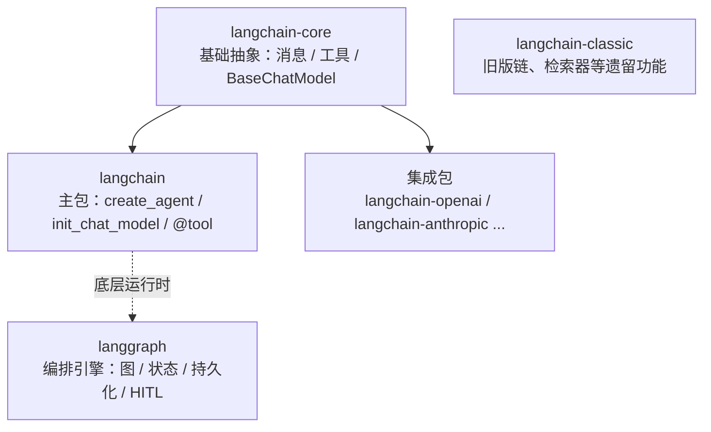
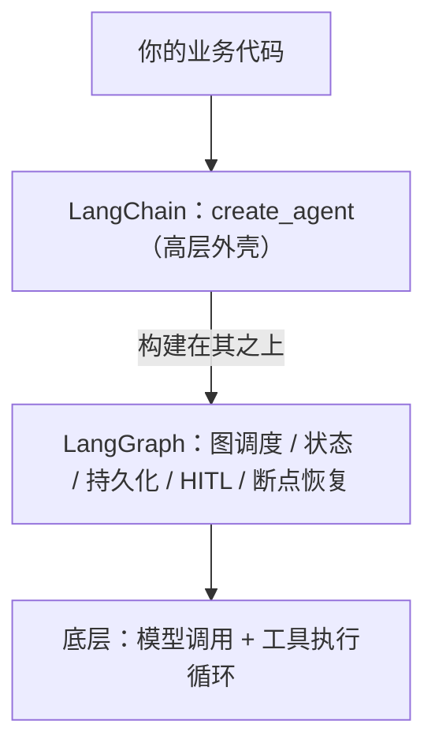

# 9.5. LangChain 入门：定位、生态与它和 LangGraph 的关系

## 适用人群

这篇文档适合已经学过 Agent 基础、工具调用、RAG，准备动手搭 Agent，又被 "LangChain 和 LangGraph 到底什么关系" 困住的学习者。建议和 [10.LangGraph入门：作用、优势、常用API与应用场景.md](/Users/chenmingdong01/Documents/AI/agent/05-Agent/10.LangGraph入门：作用、优势、常用API与应用场景.md) 配套阅读。

## 学习目标

读完后你应该能够：

1. 用一句话说清 LangChain 是什么、定位在哪一层
2. 理解 LangChain 的包结构（core / 主包 / 集成包 / classic）
3. 掌握最常用的高层 API：`create_agent`、`init_chat_model`、`@tool`
4. **讲清 LangChain 和 LangGraph 的关系，并知道什么时候用哪个**
5. 判断一个需求该停在 LangChain 高层，还是下沉到 LangGraph 自定义编排

## 目录

1. [什么是 LangChain](#1-什么是-langchain)
2. [它解决什么问题](#2-它解决什么问题)
3. [核心概念与包结构](#3-核心概念与包结构)
4. [核心 API：功能与说明](#4-核心-api功能与说明)
5. [LangChain 与 LangGraph 的关系（重点）](#5-langchain-与-langgraph-的关系重点)
6. [什么时候用 LangChain，什么时候下沉到 LangGraph](#6-什么时候用-langchain什么时候下沉到-langgraph)
7. [常见误区或失败原因](#7-常见误区或失败原因)
8. [实战建议与练习题](#8-实战建议与练习题)
9. [参考答案与思考方向](#9-参考答案与思考方向)
10. [总结与下一步建议](#10-总结与下一步建议)

## 1. 什么是 LangChain

LangChain 是目前最主流的 **大模型应用开发框架**。它把 "调用模型、挂工具、拼上下文、让模型循环决策" 这一整套事情做了标准化封装，让你不用对每家模型、每个工具都重复造轮子。

在 LangChain v1（1.0）里，它的定位被进一步收敛成一句话：

> **Agent = Model + Harness（模型 + 外壳）**

这里的 "Harness（外壳）" 指的是模型循环之外的所有东西：提示词、工具、以及塑造行为的中间件（middleware）。LangChain 的核心任务，就是帮你把这个外壳搭好。

可以这样建立直觉：

- LangChain v0 时代：一个 "什么都有" 的大工具箱（链 Chain、Agent、检索器、各种集成），灵活但臃肿
- LangChain v1 时代：主包被瘦身成 **以 Agent 为中心** 的框架，入口就是一个 `create_agent`

一句话：**LangChain 是你开发 Agent 的高层脚手架，让你用几行代码就跑起一个带工具、可循环决策的 Agent。**

## 2. 它解决什么问题

如果不用框架，自己手搓一个 Agent，你会反复遇到这些事：

1. 每接一个新模型（OpenAI / Anthropic / Gemini / 本地模型），API 格式都不一样
2. 工具调用（function calling）的协议、解析、报错处理要重写
3. "调用模型 → 模型要工具 → 执行工具 → 把结果喂回去 → 再问模型" 这个循环要自己写
4. 想加流式输出、加人工审核、加对话记忆，又得各自造轮子
5. 不同 provider 返回的 reasoning、引用、结构化内容格式全不一样，难统一处理

LangChain 用三样东西来抹平这些差异：

1. **标准模型接口**：一套接口统一所有 chat model、embedding，换模型几乎只改一行
2. **标准工具与消息抽象**：`@tool` 装饰器定义工具，统一的 message / `content_blocks` 表达内容
3. **开箱即用的 Agent 循环**：`create_agent` 把那个决策循环帮你写好，还能用中间件扩展

## 3. 核心概念与包结构

LangChain v1 不是一个大包，而是 **分层的一组包**。理解这个分层，是看懂它和 LangGraph 关系的前提。



1. **`langchain-core`**：最底层的基础抽象。消息类型、`content_blocks`、`@tool`、`BaseTool`、`BaseChatModel` 等都定义在这里，主包只是把它们重新导出。
2. **`langchain`（主包）**：v1 里被瘦身成以 Agent 为中心，核心模块：
   - `langchain.agents`：`create_agent`、`AgentState`
   - `langchain.chat_models`：`init_chat_model`、`BaseChatModel`
   - `langchain.messages`：消息类型、`content_blocks`、`trim_messages`
   - `langchain.tools`：`@tool`、`BaseTool`
3. **集成包**：每家 provider 一个独立包，如 `langchain-openai`、`langchain-anthropic`、`langchain-aws`、`langchain-google-genai`、`langchain-ollama`。按需安装，避免把所有依赖都装上。
4. **`langchain-classic`**：v1 把旧版的 Chain（如 `langchain.chains` 下的实现）、部分检索器、索引 API、`langchain-community` 导出等 **遗留功能** 搬到了这里。如果你在迁移老代码，import 路径从 `langchain.chains` 改成 `langchain_classic.chains`。

安装（Python 3.10+）：

```bash
pip install -U langchain
pip install -U langchain-openai      # 用 OpenAI
pip install -U langchain-anthropic   # 用 Claude
```

## 4. 核心 API：功能与说明

下面是上手阶段最该先掌握的几个 API。

### 4.1 `create_agent(...)`（`langchain.agents`）

功能：v1 里 **构建 Agent 的标准入口**，一个 "最小但高度可配置的外壳"。它内部帮你跑好基础 Agent 循环：调用模型 → 选择工具 → 没有工具可调时结束。

常见参数：

1. `model`：模型，可传 provider 前缀字符串（如 `"openai:gpt-5.5"`、`"claude-sonnet-4-6"`），也可传模型对象
2. `tools`：工具列表（普通 Python 函数或 `BaseTool`）
3. `system_prompt`：系统提示词
4. `middleware`：中间件列表，用来扩展行为（见 4.4）

调用：`agent.invoke({"messages": [{"role": "user", "content": "..."}]})`，输出可从 `result["messages"][-1].content_blocks` 读取。

> 注意：`create_agent` 取代了旧版 `langgraph.prebuilt.create_react_agent`，是 1.0 推荐写法。

### 4.2 `init_chat_model(...)`（`langchain.chat_models`）

功能：用统一接口初始化任意 provider 的 chat model，是 "标准模型接口" 的入口。换模型基本只改模型字符串，业务代码不动。

### 4.3 `@tool` / `BaseTool`（`langchain.tools`）

功能：把一个普通函数声明成工具。多数情况下，一个带类型标注和 docstring 的 Python 函数直接放进 `tools=[...]` 就能用，`@tool` 用于需要更精细控制时。

### 4.4 中间件（Middleware）

功能：`create_agent` 的灵魂特性。通过 `before_model`、`wrap_model_call`、`wrap_tool_call`、`after_agent` 等钩子，在 Agent 循环的各个环节插入自定义逻辑（护栏、重试、路由、工具策略）。官方还提供预制中间件，如 `PIIMiddleware`（脱敏）、`SummarizationMiddleware`（上下文摘要）、`HumanInTheLoopMiddleware`（人工介入）。

### 4.5 `content_blocks`

功能：v1 新增的 **标准内容块**，为不同 provider 的消息内容提供统一表达。好处是 provider 无关、类型安全、向后兼容——用同一套 API 就能拿到推理过程、引用、内置工具调用等内容。

## 5. LangChain 与 LangGraph 的关系（重点）

这是最多人困惑的地方，一句话先给结论：

> **LangChain 是高层的 Agent 开发框架，LangGraph 是它底层的编排运行时。LangChain 的 Agent 就跑在 LangGraph 上。**

### 5.1 分层关系



- `create_agent` 返回的 Agent，**底层就是一张 LangGraph 图**。
- 因此 LangChain 的 Agent 天生就带着 LangGraph 的能力：持久化（persistence）、流式（streaming）、人工介入（human-in-the-loop）、时间旅行（time travel / 回放）。
- 你不用显式写图，LangChain 已经帮你把那张标准的 ReAct 图搭好了。

### 5.2 一个比喻

- **LangGraph 像发动机 / 编排引擎**：定义节点、边、状态怎么流转，功能强但要自己拼装。
- **LangChain 像装好发动机的整车 + 高速公路**：你直接 `create_agent` 上路，不用关心引擎内部怎么转。
- 当标准车满足不了你（需要特殊的分支、并发、子图、复杂状态机），你就 **掀开引擎盖，直接用 LangGraph 自定义那张图**。

### 5.3 对比表

| 维度 | LangChain | LangGraph |
| --- | --- | --- |
| 定位 | 高层 Agent 开发框架 | 底层编排运行时 / 引擎 |
| 核心入口 | `create_agent` | `StateGraph` + 节点/边 |
| 抽象层级 | Model + Harness（外壳） | State + Node + Edge（图） |
| 你写什么 | 配置模型、工具、中间件 | 显式定义状态、节点、路由 |
| 控制粒度 | 中（靠中间件扩展） | 细（任意控制流、并发、子图） |
| 关系 | **构建在 LangGraph 之上** | **LangChain Agent 的运行时** |
| 上手成本 | 低，几行代码起步 | 中，需理解图模型 |

### 5.4 常见误解澄清

1. **"二选一"？** 不是。多数项目是 **同时用**：默认用 LangChain 的 `create_agent`，遇到复杂编排时在同一套体系里下沉到 LangGraph。
2. **"LangGraph 是 LangChain 的一个模块"？** 更准确说，它是 LangChain 依赖的 **底层独立框架**，可以单独使用（只用 LangGraph 不用 LangChain 的高层封装也完全可以）。
3. **"用了 LangChain 就用不到 LangGraph 概念"？** 恰恰相反，一旦你要定制 Agent 的控制流，LangGraph 的 `State / Node / Edge / checkpointer / interrupt` 就会浮上来。

## 6. 什么时候用 LangChain，什么时候下沉到 LangGraph

### 6.1 直接用 LangChain（`create_agent`）就够

1. 标准的 "模型 + 工具 + 系统提示" 的 ReAct 型 Agent
2. 需求能被中间件覆盖（脱敏、摘要、简单人审、重试）
3. 想快速起步、快速验证业务价值
4. 需要在多家模型间切换，看重统一接口

### 6.2 下沉到 LangGraph 自定义图

1. 复杂、显式的分支与路由，`if/else` 已经 hold 不住
2. 需要 map-reduce / fan-out 并发（`Send`）
3. 需要多 Agent、子图、复杂状态机
4. 需要对中断点、恢复、回放做精细控制
5. 需要把 "状态字段边界" 设计得非常清楚（见 LangGraph 文档第 7 节误区）

一个健康的演进路径：**先 `create_agent` 跑通 → 发现控制流不够用 → 在 LangGraph 里重写那张图**。因为底层本来就是 LangGraph，这个下沉是平滑的，不是推倒重来。

## 7. 常见误区或失败原因

1. 把 LangChain 当成 "必须用的东西"：简单单轮任务直接调模型 SDK 更清爽，别为了框架而框架
2. 还在用 v0 的 `LLMChain`、`initialize_agent` 等旧写法：v1 已把这些搬到 `langchain-classic`，新项目应直接用 `create_agent`
3. 一股脑装 `langchain` 却不装对应集成包（如 `langchain-anthropic`），导致模型连不上
4. 分不清高层和底层，遇到复杂控制流时在 `create_agent` 里硬塞逻辑，而不是下沉到 LangGraph
5. 忽略 `content_blocks`，还在用字符串拼接去解析各家 provider 的返回

## 8. 实战建议与练习题

### 8.1 实战建议

1. 第一个 Agent 用 `create_agent` + 1~2 个工具跑通，别一上来就上 LangGraph
2. 把模型写成可配置字符串（如 `"claude-sonnet-4-6"`），验证 "换模型只改一行"
3. 需要新增横切能力（脱敏/摘要/人审）时，优先找 **预制中间件**，而不是改业务代码
4. 当你第一次想写复杂 `if/else` 路由时，就是该读 LangGraph 文档、准备下沉的信号
5. 新项目不要引入 `langchain-classic` 里的旧链；只有迁移老代码才用它

### 8.2 练习题

1. 用 `create_agent` 写一个带 "查天气" 工具的 Agent，并让它只用改一行就能在 OpenAI 和 Claude 之间切换
2. 给上面的 Agent 加一个 `HumanInTheLoopMiddleware`，让它在调用某个敏感工具前先暂停等人确认
3. 说明：同样是 "人工审核"，用 LangChain 中间件实现 和 用 LangGraph `interrupt` 实现，分别适合什么场景

## 9. 参考答案与思考方向

1. 题 1 关键在 "标准模型接口"：工具用普通函数，模型用 `init_chat_model` 或 `create_agent` 的 `model` 字符串参数，切换 provider 只改那一个字符串，并记得装对应集成包。
2. 题 2 要点是 "横切能力用中间件"：把人审逻辑放进中间件钩子（如工具调用前的 `wrap_tool_call`），业务工具本身不感知审核流程。
3. 题 3 思考方向：中间件适合 **标准化、可复用** 的人审策略（在高层外壳里统一管）；LangGraph `interrupt` 适合 **流程中特定节点、需要和自定义状态强耦合** 的精细人审。前者图省事，后者图可控。

## 10. 总结与下一步建议

- **LangChain = 高层 Agent 开发框架**，入口是 `create_agent`，核心理念是 "Model + Harness"。
- **LangGraph = 底层编排运行时**，LangChain 的 Agent 就建在它之上，所以持久化、流式、人审、回放这些能力是 "白送" 的。
- 二者不是二选一：**默认用 LangChain 快速起步，复杂编排时平滑下沉到 LangGraph**。

下一步建议：

1. 动手跑 [agent-langchain-tour](/Users/chenmingdong01/Documents/AI/agent/07-项目实战/agent-langchain-tour)，用 8 个小脚本把 LangChain 的模型/消息/提示词/工具/短期+长期记忆/记忆管理/高级功能横向走一遍
2. 继续阅读 [10.LangGraph入门：作用、优势、常用API与应用场景.md](/Users/chenmingdong01/Documents/AI/agent/05-Agent/10.LangGraph入门：作用、优势、常用API与应用场景.md)，把底层图模型补齐
3. 动手跑 [3.LangGraph聊天Agent实战.md](/Users/chenmingdong01/Documents/AI/agent/07-项目实战/3.LangGraph聊天Agent实战.md)，体会 "高层下沉到图" 的过程
4. 想对比不用框架的手搓方式，可看 [agent-from-scratch](/Users/chenmingdong01/Documents/AI/agent/07-项目实战/agent-from-scratch) 项目

## 参考资料

1. LangChain 概览（官方）：[https://docs.langchain.com/oss/python/langchain/overview](https://docs.langchain.com/oss/python/langchain/overview)
2. LangChain 安装（官方）：[https://docs.langchain.com/oss/python/langchain/install](https://docs.langchain.com/oss/python/langchain/install)
3. LangChain v1 发布说明（官方）：[https://docs.langchain.com/oss/python/releases/langchain-v1](https://docs.langchain.com/oss/python/releases/langchain-v1)
4. `create_agent`（官方）：[https://docs.langchain.com/oss/python/langchain/agents](https://docs.langchain.com/oss/python/langchain/agents)
5. 中间件 Middleware（官方）：[https://docs.langchain.com/oss/python/langchain/middleware](https://docs.langchain.com/oss/python/langchain/middleware)
6. LangGraph 概览（官方）：[https://docs.langchain.com/oss/python/langgraph](https://docs.langchain.com/oss/python/langgraph)

