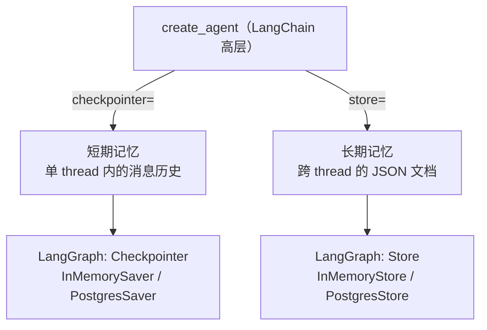

# agent-langchain-tour —— LangChain v1 全景实战

> 用 9 个可独立运行的小脚本，把 **LangChain 最常用的能力** 走一遍：
> 调用模型 → 消息 → 提示词工程 → 工具定义与调用 → 短期记忆 → 长期记忆 → 记忆管理策略 → 高级功能 → 多模型切换。
>
> 配套讲义：[05-Agent/9.5.LangChain入门：定位、生态与它和LangGraph的关系.md](/Users/chenmingdong01/Documents/AI/agent/05-Agent/9.5.LangChain入门：定位、生态与它和LangGraph的关系.md)（先读讲义，再跑本项目）。

## 目录

1. [项目定位](#1-项目定位)
2. [环境与运行](#2-环境与运行)
3. [七大维度逐节讲](#3-七大维度逐节讲)
4. [高级功能与适用场景](#4-高级功能与适用场景)
5. [LangChain 记忆 vs LangGraph 记忆](#5-langchain-记忆-vs-langgraph-记忆)
6. [v0 → v1 关键差异（重要）](#6-v0--v1-关键差异重要)
7. [常见误区](#7-常见误区)
8. [练习题](#8-练习题)
9. [配套学习与下一步](#9-配套学习与下一步)

## 1. 项目定位

| 项目 | 层级 | 回答的问题 |
|---|---|---|
| [agent-from-scratch](/Users/chenmingdong01/Documents/AI/agent/07-项目实战/agent-from-scratch) | L0 手写内核 | Agent 的「循环」到底是什么 |
| **本项目 agent-langchain-tour** | **框架·横向** | **LangChain 这个框架都给我哪些能力、怎么用** |
| [agent-chat-langgraph](/Users/chenmingdong01/Documents/AI/agent/07-项目实战/agent-chat-langgraph) | 框架·编排 | 用 LangGraph 显式编排一个聊天 Agent |

本项目是 **横向扫一遍 LangChain 的使用面**，不是做一个完整应用。每个脚本只聚焦一个主题、尽量短，读完 + 跑通就能建立"LangChain 能做什么、API 长什么样"的全局认知。

> 版本：**LangChain v1（1.0+）**。入口是 `create_agent`，底层运行时是 LangGraph。为什么是 v1、它和 LangGraph 什么关系，见讲义 9.5。

## 2. 环境与运行

### 2.1 安装依赖

```bash
cd 07-项目实战/agent-langchain-tour
pip install -r requirements.txt
```

### 2.2 配置 `.env`

本项目**只读本目录下的 `.env`**（不依赖任何其他项目），**两种格式二选一**，[common.py](common.py) 的 `get_model()` 会自动识别你配了哪种（你的环境对 `.env` 有写保护，需你自己创建）。

**方式一：Gemini 秘钥 / Google（`GOOGLE_*` 变量）**

```bash
# .env —— AI Studio（个人学习首选，有免费额度：https://aistudio.google.com/apikey）
GOOGLE_GENAI_USE_VERTEXAI=FALSE
GOOGLE_API_KEY=你的_AI_Studio_Key
# MODEL=gemini-2.5-flash   # 可选，缺省就是它
```

```bash
# .env —— 或走 Vertex AI（企业 / GCP）
GOOGLE_GENAI_USE_VERTEXAI=TRUE
GOOGLE_CLOUD_PROJECT=xiling-453607
GOOGLE_CLOUD_LOCATION=global
GOOGLE_APPLICATION_CREDENTIALS=/path/to/service-account.json
```

**方式二：api_key 方式 / OpenAI 兼容端点**

```bash
# .env
OPENAI_API_KEY=sk-xxxx
OPENAI_BASE_URL=                  # 可选：用代理/厂内网关时填，官方 OpenAI 留空
# MODEL=gpt-4o-mini               # 可选，缺省就是它；接厂内网关记得填网关上真实存在的模型名
```

> - 识别优先级：**显式 `PROVIDER`** > **按已配凭据自动识别**（Vertex > Gemini 秘钥 > OpenAI）。同时配了多种凭据、或想强制某一家时，用 `PROVIDER=openai|gemini|vertex` 一锤定音。
> - `MODEL` 两种方式通用：不填按识别到的 provider 用默认模型（OpenAI→`gpt-4o-mini`，Google→`gemini-2.5-flash`）；填了裸模型名会自动补 provider 前缀，也可直接写成 `provider:model`（如 `google_genai:gemini-2.5-flash`、`openai:gpt-5.6-sol`）。
> - 走本地代理时在**本目录 `.env`** 里加 `HTTPS_PROXY=http://127.0.0.1:7890`（httpx 自动读取）。走 **Vertex AI** 时它底层用 gRPC，而 gRPC 的 C-core 只认**小写**的 `https_proxy`/`grpc_proxy`——[common.py](common.py) 已自动把大写镜像成小写，所以你照常只配大写即可，不会出现「绕过代理、卡 60 秒再超时」。接**厂内** OpenAI 网关（如 `oneapi-comate.baidu-int.com`）时**别**配这个翻墙代理，直连即可。
> - 依赖按方式二选一安装对应集成包：方式一 `langchain-google-genai`（Vertex 另加 `langchain-google-vertexai`），方式二 `langchain-openai`——见 [requirements.txt](requirements.txt)。

### 2.3 逐个运行

```bash
python 01_models.py          # 调用模型
python 02_messages.py        # 消息
python 03_prompts.py         # 提示词工程
python 04_tools.py           # 工具定义与调用
python 05_short_term_memory.py   # 短期记忆
python 06_long_term_memory.py    # 长期记忆
python 07_memory_management.py   # 记忆管理策略
python 08_advanced.py        # 高级功能
python 09_multi_provider.py  # 多模型切换 / 容灾
```

> 说明：`04`~`09` 里的 Agent / 模型演示依赖可用 Key 才能真正跑；
> 没 Key 时脚本会友好提示并退出。部分「纯本地」演示（如 `04` 的工具对象、`06` 的 Store 增删查、`07` 的删除说明）无需 Key 也能看。`08` 最后的 HITL 演示是**交互式**的，会用 `input()` 等你敲 `y`/其它来 approve/reject。`09` 的多模型切换需要你 `.env` 里配了对应 provider 的凭据（缺的那家会被自动跳过）。

> **一行日志（看模型的完整入参/返回/耗时）**：[common.py](common.py) 里挂了个 LangChain 回调，**默认开启**，每次访问模型都会打一行 `[llm] 入参=... | 返回=... | 耗时=...s`——完整的消息历史（含工具调用与结果回填）、完整返回（文字 / `tool_calls` / usage）、本次耗时。因为挂在模型上，`invoke`/`stream`/`batch` 乃至 **Agent 内部每一次模型调用**都会被打到，业务脚本一行不用改。想关掉设 `LLM_LOG=0`（如 `LLM_LOG=0 python 04_tools.py`）。

## 3. 七大维度逐节讲

### 3.1 调用模型 —— [01_models.py](01_models.py)

- **是什么**：用一个统一入口调用任意厂商的 chat model。
- **核心 API**：`init_chat_model("openai:gpt-4o-mini")`；`model.invoke()` / `.stream()`（流式）/ `.batch()`（批量并发）。
- **最小代码**：

  ```python
  from langchain.chat_models import init_chat_model
  model = init_chat_model("openai:gpt-4o-mini")
  print(model.invoke("你好").text)
  ```

- **常见坑**：裸模型是**无状态**的，自己不记上文；多轮要么手动拼 history（见 3.2），要么交给 Agent 的记忆（见 3.5）。

### 3.2 消息 —— [02_messages.py](02_messages.py)

- **是什么**：LangChain 用「消息对象」组织对话，而不是一个大字符串。
- **核心 API**：`SystemMessage / HumanMessage / AIMessage / ToolMessage`（`langchain.messages`）；也可用等价的字典写法 `{"role": "user", "content": "..."}`；响应的 `.content_blocks` 是 v1 的**标准内容块**，provider 无关地取文本/推理/引用。
- **多轮关键**：把模型回复（`AIMessage`）也追加回消息列表，模型才有上下文。
- **常见坑**：只把用户消息塞回去、忘了把上一轮 `AIMessage` 也放回，模型就"失忆"。

### 3.3 提示词工程 —— [03_prompts.py](03_prompts.py)

- **是什么**：把提示词和变量解耦，复用一套模板处理不同输入。
- **核心 API**：`ChatPromptTemplate.from_messages([...])` + `prompt | model` 管道；few-shot 把「输入→输出」示例写进模板；`@dynamic_prompt` 中间件按运行时上下文**动态**生成 system prompt。
- **场景**：固定任务用模板；需要按用户等级/语言/权限实时调整系统提示时，用 `@dynamic_prompt`。
- **常见坑**：把本该放进模板变量的东西用 f-string 拼进提示词，容易注入、也难维护。

### 3.4 工具定义与调用 —— [04_tools.py](04_tools.py)

- **是什么**：给模型"手脚"，让它能查天气、算数、调接口。
- **核心 API**：`@tool` 把普通函数声明成工具（**类型标注 + docstring 就是给模型看的说明书**）；`create_agent(model, tools=[...], system_prompt=...)` 一行搭好会自动调工具的 Agent。
- **怎么跑起来的**：模型产出 `AIMessage(tool_calls)` → 框架执行工具 → 结果以 `ToolMessage` 回填 → 模型据此作答，这就是 ReAct 循环（和 L0 的 agent-from-scratch 手写的是同一个循环，这里被框架藏起来了）。
- **常见坑**：docstring/类型标注写得含糊，模型就不知道何时该调、参数怎么填。

### 3.5 短期记忆 —— [05_short_term_memory.py](05_short_term_memory.py)

- **是什么**：同一个会话里自动记住上文，不用你手动拼 history。
- **核心机制**：`checkpointer=InMemorySaver()` + 调用时 `config={"configurable": {"thread_id": "..."}}`。同一个 `thread_id` = 同一个会话；不同 `thread_id` 天然隔离。
- **最小代码**：

  ```python
  from langgraph.checkpoint.memory import InMemorySaver
  agent = create_agent(model, tools=[], checkpointer=InMemorySaver())
  cfg = {"configurable": {"thread_id": "user-A"}}
  agent.invoke({"messages": [{"role": "user", "content": "我叫小明"}]}, cfg)
  agent.invoke({"messages": [{"role": "user", "content": "我叫什么？"}]}, cfg)  # 记得
  ```

- **生产**：把 `InMemorySaver` 换成 `PostgresSaver`（`langgraph-checkpoint-postgres`）即可持久化。
- **常见坑**：忘了传 `thread_id`，每次都是新会话 → 看起来"没记忆"。

### 3.6 长期记忆 —— [06_long_term_memory.py](06_long_term_memory.py)

- **是什么**：跨会话、跨 thread 记住用户信息（偏好、档案）。
- **核心机制**：`store=InMemoryStore()`；数据按 `namespace`(文件夹) + `key`(文件名) 存成 JSON。`store.put / get / search` 读写；配 `IndexConfig(embed=..., dims=...)` 后 `store.search(query=...)` 支持**语义检索**。
- **接进 Agent**：把 `store` 传给 `create_agent`，工具内用 `runtime.store` 读写，`user_id` 走 `context_schema` 传入。
- **短期 vs 长期**：短期是"这次对话记得"，长期是"下次来还记得"。
- **常见坑**：namespace 不带 `user_id`，多用户数据串台。

### 3.7 记忆管理策略 —— [07_memory_management.py](07_memory_management.py)

对话变长会撑爆上下文、变慢变贵。三种策略，都通过 `middleware=` 挂上：

| 策略 | API | 适用场景 |
|---|---|---|
| 裁剪 Trim | `@before_model` + `RemoveMessage(REMOVE_ALL_MESSAGES)` 重放保留部分 / `trim_messages` 工具 | 只关心最近几轮、历史可丢 |
| 摘要 Summarize | `SummarizationMiddleware(trigger=("tokens", N), keep=("messages", M))` | 长对话但早期信息仍有价值 |
| 删除 Delete | `RemoveMessage(id=...)`（常在 `@after_model`） | 撤回敏感内容、剔除失败工具调用 |

- **常见坑**：删/裁之后历史对该 provider 不再合法（如留下一个没有对应 `ToolMessage` 的 `tool_calls`）会报错——要保证裁剪后消息序列仍成立。

## 4. 高级功能与适用场景

见 [08_advanced.py](08_advanced.py)（结构化输出 / 流式 / 中间件 / HITL）与 [09_multi_provider.py](09_multi_provider.py)（多模型切换）。这些是"从 Demo 到生产"真正用得上的能力：

| 功能 | 核心 API | 典型场景 |
|---|---|---|
| 结构化输出 | `create_agent(..., response_format=PydanticModel)`，读 `result["structured_response"]` | 信息抽取、意图分类、生成表单/工单 |
| 流式 | `agent.stream(..., stream_mode="updates"/"messages"/"values")` | 前端实时轨迹、长任务进度、排障 |
| 自定义中间件 | 装饰器 `@before_model`/`@after_model`/`@wrap_model_call`/`@wrap_tool_call`（`langchain.agents.middleware`） | 护栏、改写输入、埋点、按条件短路/路由 |
| 内置中间件 | `SummarizationMiddleware`（摘要）、`HumanInTheLoopMiddleware`（人审）等 | 上下文压缩、敏感操作人工确认、PII 脱敏 |
| 人工介入 HITL | `HumanInTheLoopMiddleware(interrupt_on={...})` + `checkpointer` + `Command(resume=...)` | 下单/转账/删库/发邮件前强制确认 |
| 多模型切换（→[09](09_multi_provider.py)） | 只改 `"provider:model"` 字符串；容灾用 `model.with_fallbacks([backup])` | 容灾切换、按难度分配贵/便宜模型、按能力选型 |

> 为什么多模型切换单独成 [09_multi_provider.py](09_multi_provider.py)：08 的几项都是「Agent 执行层」能力，而多模型切换是「模型层」的事，和 [01_models.py](01_models.py) 一脉相承。09 用你 `.env` 里的两套凭据（openai 厂内 + google Vertex）**真实**跑了「同代码切换」和「`.with_fallbacks` 容灾」。

> 关于 HITL：[08_advanced.py](08_advanced.py) 的 `demo_hitl()` 是一个**真能跑的交互式**演示——模型想调 `send_email`（标记为敏感）时会**暂停**，命令行里等你敲 `y` 批准 / 其它拒绝，再 `Command(resume=...)` 恢复。它天然是「两阶段：第一次 `invoke` 跑到敏感工具前暂停并返回 `__interrupt__` → 你决定 → 第二次 `invoke(Command(resume=...))` 恢复」，所以**必须配 `checkpointer`**。这套中断/恢复和 LangGraph 的 `interrupt` 是同一套，详见 [05-Agent/10.LangGraph入门...md](/Users/chenmingdong01/Documents/AI/agent/05-Agent/10.LangGraph入门：作用、优势、常用API与应用场景.md)。
>
> 关于结构化输出的「策略」：`response_format` 直接传 Pydantic 模型会按 provider 能力**自动选策略**，支持原生结构化输出的厂商走 `ProviderStrategy`。但各家「原生 JSON 模式」实现参差，个别模型（如部分 Gemini 版本）可能返回无法解析的内容而报错。更稳的做法是显式用 `ToolStrategy(PydanticModel)`（`langchain.agents.structured_output`）——让模型以「调用一个工具」的方式交出对象，provider 无关。[08_advanced.py](08_advanced.py) 用的就是 `ToolStrategy`。

## 5. LangChain 记忆 vs LangGraph 记忆

这是最容易混的点，一张图说清：



- **记忆能力其实来自底层的 LangGraph**：短期靠 Checkpointer，长期靠 Store。
- LangChain 只是把它们通过 `create_agent` 的 `checkpointer=` / `store=` 参数**暴露给你**。
- 所以你在本项目学到的记忆用法，和直接用 LangGraph 写图时是**同一套东西**——呼应讲义 9.5 的"LangChain 建在 LangGraph 之上"。

## 6. v0 → v1 关键差异（重要）

网上大量旧教程是 v0 的，照抄会踩坑。最该知道的几点：

1. **入口变了**：旧的 `initialize_agent` / `AgentExecutor` / `create_react_agent`(prebuilt) → 统一用 `langchain.agents.create_agent`。
2. **记忆彻底变了**：旧的 `ConversationBufferMemory` / `ConversationSummaryMemory` 等 Memory 类**已不再是推荐方式**，被 checkpointer（短期）+ Store（长期）+ 中间件（摘要/裁剪）取代。
3. **命名空间瘦身**：旧的 `LLMChain`、很多链、检索器、索引 API、`langchain-community` 导出，统一搬到了 **`langchain-classic`**（import 从 `langchain.chains` → `langchain_classic.chains`）。
4. **内容统一**：新增 `content_blocks` 标准内容块，跨厂商取 reasoning/引用/内置工具用同一套 API。
5. **结构化输出更省**：在主循环内生成，通常不再额外多花一次 LLM 调用。

> 一句话：**新项目直接用 `create_agent` + checkpointer/store + middleware，不要再引入 v0 的 Chain/Memory 老写法。**

## 7. 常见误区

- 以为"记忆 = 一个 Memory 对象"：v1 里记忆是 checkpointer（短期）/ Store（长期）/ 中间件（管理）三件事。
- 以为 LangChain 和 LangGraph 二选一：实际是 LangChain 建在 LangGraph 上，默认用 LangChain，复杂编排再下沉。
- 工具 docstring 随便写：那是模型调用工具的唯一依据，等于接口文档。
- 对话无限增长不做管理：迟早撑爆上下文，必须选裁剪/摘要/删除之一。
- 把 Key、base_url 写进代码：应走 `.env`，避免泄露、方便切换。

## 8. 练习题

1. 给 [04_tools.py](04_tools.py) 加一个 `search(keyword)` 工具，观察模型如何自己决定调用它。
2. 用 [05](05_short_term_memory.py) 的 checkpointer + [06](06_long_term_memory.py) 的 store 组合出一个"既记得本次对话、又跨会话记得我是谁"的 Agent。
3. 给一个长对话分别套上 Trim 和 Summarize（[07](07_memory_management.py)），对比两者在"记得多少信息"和"token 省多少"上的差异。
4. 用 `response_format`（[08](08_advanced.py)）把一段简历文本抽取成结构化对象，并处理抽取失败的情况。

**参考方向**：题 2 关键是 `create_agent(..., checkpointer=..., store=...)` 两个参数同时传；题 3 关注"信息保真 vs 成本"的权衡，Trim 便宜但丢信息，Summarize 保信息但多一次模型调用；题 4 结构化失败时可加校验/重试或降级为纯文本。

## 9. 配套学习与下一步

1. 先读讲义：[05-Agent/9.5.LangChain入门...md](/Users/chenmingdong01/Documents/AI/agent/05-Agent/9.5.LangChain入门：定位、生态与它和LangGraph的关系.md)
2. 再读本项目并逐个跑脚本
3. 想看"下沉到 LangGraph 显式编排"：[05-Agent/10.LangGraph入门...md](/Users/chenmingdong01/Documents/AI/agent/05-Agent/10.LangGraph入门：作用、优势、常用API与应用场景.md) + [agent-chat-langgraph](/Users/chenmingdong01/Documents/AI/agent/07-项目实战/agent-chat-langgraph)
4. 想看"记忆系统"更系统的理论：[05-Agent/8.Agent记忆系统.md](/Users/chenmingdong01/Documents/AI/agent/05-Agent/8.Agent记忆系统.md) + [agent-memory-enhanced](/Users/chenmingdong01/Documents/AI/agent/07-项目实战/agent-memory-enhanced)

## 参考资料

1. LangChain 概览（官方）：https://docs.langchain.com/oss/python/langchain/overview
2. 短期记忆（官方）：https://docs.langchain.com/oss/python/langchain/short-term-memory
3. 长期记忆（官方）：https://docs.langchain.com/oss/python/langchain/long-term-memory
4. 中间件（官方）：https://docs.langchain.com/oss/python/langchain/middleware
5. 结构化输出（官方）：https://docs.langchain.com/oss/python/langchain/structured-output
6. LangChain v1 发布说明（官方）：https://docs.langchain.com/oss/python/releases/langchain-v1

